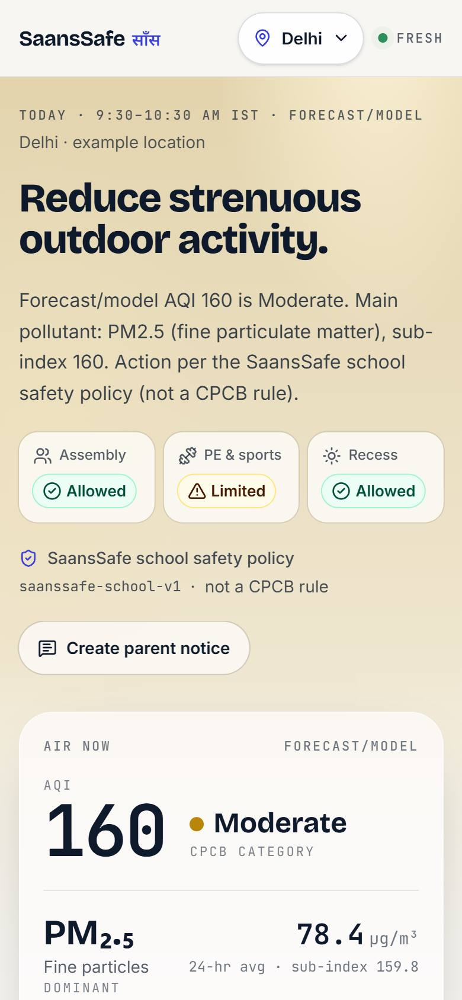
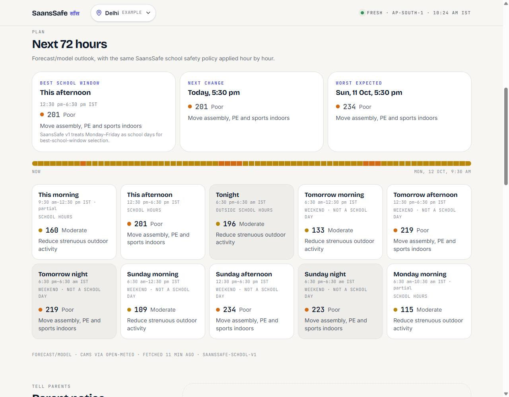
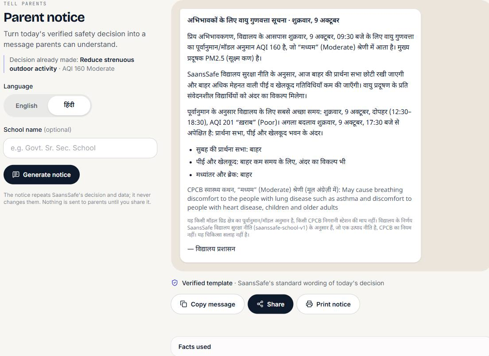
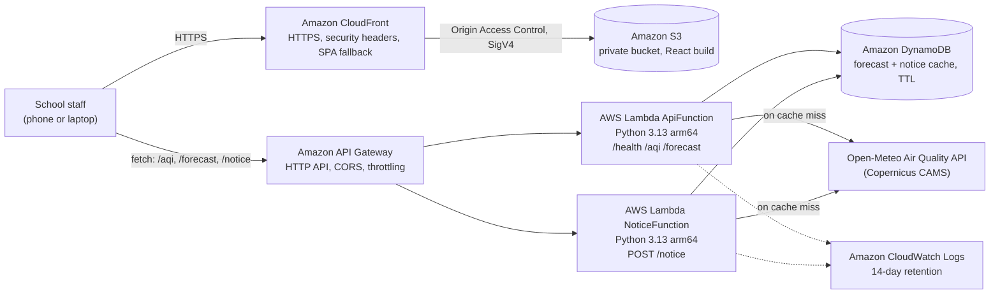

# SaansSafe साँस

**Can students go outside today?** SaansSafe turns India's air-quality forecast into a clear, explainable plan for school assembly, PE and sports, and recess, plus a parent notice in English or Hindi.

Built for **Environmental Hacks** (Bharat Builds Tour, WeMakeDevs × AWS, Oct 8–11 2026), **Air track**, by team **Shadow Protocol** (Subhadeep Roy and Sneha Singha).

**Live app: https://d316zs0sydbi1r.cloudfront.net** · **Demo video (2:44): https://www.youtube.com/watch?v=7fcaFbYrZwM** · [Writeup](WRITEUP.md)

[](https://www.youtube.com/watch?v=7fcaFbYrZwM)

| Today's decision (mobile) | 72-hour school outlook | Parent notice in Hindi |
|---|---|---|
|  |  |  |

<sub>Screenshots of the live app (Delhi example location, 9 Oct 2026). Desktop view: [docs/screenshots/desktop-decision.jpeg](docs/screenshots/desktop-decision.jpeg).</sub>

## The problem

School principals and PE teachers in Indian cities have to decide, often first thing in the morning, whether children should line up outdoors for assembly, run in PE, or play at recess. The AQI is published, but turning "AQI 287" into "move assembly indoors, keep recess short" is left to each school. CPCB's own health statement for the "Moderate" category already names children as a group that may feel breathing discomfort.

SaansSafe is for the **person who makes that call at a school**. They pick the school's location, and SaansSafe answers in one line, explains why, shows the next three days, and drafts the message for parents.

## What it does

- **Today's decision:** one headline action (for example "Move assembly, PE and sports indoors") with per-activity guidance (Allowed / Limited / Move indoors) and a short checklist.
- **Why this decision?** The data, the CPCB category and health statement, the SaansSafe policy version, and the decision, step by step.
- **Next 72 hours:** the same policy applied hour by hour. Shows the best school window (full school-hours periods on Monday–Friday only), the next change, the worst expected hour, and morning, afternoon and night periods in IST.
- **Parent notice:** a ready-to-send notice in **English or हिंदी**, with copy, share and print. It repeats the decision and never changes it.
- **Pollutant detail and provenance:** concentrations, dominant pollutant, model grid cell, fetch time, cache status and policy version are always visible.
- **Works on a phone:** decision-first layout tested at 320–1440 px.

## How a decision is made

```
Open-Meteo air-quality forecast (Copernicus CAMS model, hourly)
  → CPCB National AQI engine (sub-indices, rolling averages, category)
  → SaansSafe school safety policy saanssafe-school-v1 (deterministic lookup)
  → decision · 72-hour outlook · parent notice
```

Every number and decision is computed by tested, deterministic Python. The same inputs always produce the same output. No AI model is involved in the running app (see [AI status](#ai-status-strands-agents--amazon-bedrock)).

**Forecast/model data, not station readings.** The data are Copernicus CAMS model forecasts for a model grid cell, served by Open-Meteo. They are **not** CPCB ground-station observations, and the app labels them "forecast/model" everywhere. SaansSafe applies the CPCB method to these forecasts. That makes it useful for planning ahead, but it can differ from a nearby monitoring station.

**CPCB method.** The AQI engine (`backend/src/saanssafe/aqi.py`) follows the CPCB National AQI report (CUPS/82/2014-15):
- Each pollutant needs at least 16 valid hours in the last 24.
- PM2.5, PM10, NO2, SO2 and NH3 use 24-hour averages; O3 and CO use 8-hour averages.
- The AQI is the maximum sub-index, from at least 3 pollutants including PM2.5 or PM10.
- Above the Severe threshold, the AQI is shown as "401+" rather than an extrapolated number.

**School actions are SaansSafe policy, not CPCB rules.** CPCB defines AQI categories and health statements, but no school actions. SaansSafe maps each CPCB category to a school action:

| CPCB category | SaansSafe action (`saanssafe-school-v1`) | Assembly | PE & sports | Recess |
|---|---|---|---|---|
| Good | Outdoor activities can go ahead as normal | Allowed | Allowed | Allowed |
| Satisfactory | Outdoor activities OK; take care of sensitive students | Allowed | Allowed | Allowed |
| Moderate | Reduce strenuous outdoor activity | Allowed | Limited | Allowed |
| Poor | Move assembly, PE and sports indoors | Move indoors | Move indoors | Limited |
| Very Poor | Suspend outdoor activities | Move indoors | Move indoors | Move indoors |
| Severe | Suspend all outdoor activities | Move indoors | Move indoors | Move indoors |

SaansSafe is not medical advice. Schools should follow instructions from local and education authorities.

## Architecture on AWS



Everything is defined as code with the **AWS SAM CLI** (an AWS open-source tool) in two stacks in `ap-south-1` (Mumbai). All services are pay-per-request; there are no servers, NAT gateways or EC2.

| Service | Why |
|---|---|
| **CloudFront + private S3 (OAC)** | Serves the static React app over HTTPS from edge locations in India (`PriceClass_200`). The bucket blocks all public access; only this distribution can read it (bucket policy scoped to its ARN). Includes SPA fallback, compression and managed security headers. Stack: `infra/web/template.yaml`. |
| **API Gateway HTTP API** | Public JSON API with CORS limited to the site and local dev (`localhost:5173`), plus throttling at 10 req/s (burst 20). |
| **Lambda (2 functions)** | `ApiFunction` serves `/health`, `/aqi` and `/forecast`; `NoticeFunction` serves `POST /notice`. Python 3.13 on arm64, with no third-party runtime dependencies. |
| **DynamoDB (on-demand)** | Caches forecast data per model grid cell, fresh for 60 min, cutting Open-Meteo calls. If Open-Meteo is temporarily down, data up to 6 h old is served, clearly marked stale. Also caches generated notices. Items expire via TTL. |
| **CloudWatch Logs** | Logs for both functions, with 14-day retention. |

Stack: `backend/template.yaml`.

### API

Base URL: `https://paqffn4eq5.execute-api.ap-south-1.amazonaws.com`

| Method and path | Returns |
|---|---|
| `GET /health` | Health check |
| `GET /aqi?lat=28.6139&lon=77.2090` | Current forecast/model AQI, pollutants, `decision`, freshness and source |
| `GET /forecast?lat=28.6139&lon=77.2090` | 72-hour outlook: hourly AQI and decisions, school periods, summary |
| `POST /notice` with body `{"lat": 28.6139, "lon": 77.2090, "language": "en" \| "hi", "school_name": "optional"}` | Parent notice built from the same decision |

Errors use clear codes: 400 invalid input, 422 insufficient data, 502 bad upstream response, and 503 upstream unavailable (with `Retry-After`).

## AI status: Strands Agents + Amazon Bedrock

The repository contains an **optional** AI writer for parent notices, built with the Strands Agents SDK for Amazon Bedrock (`notice_bedrock.py`, `notice_writer.py`, `requirements-notice.txt`). It may only reword a notice; numbers and decisions are checked against the deterministic facts. It is tested with fakes.

**It is not active in production.** Bedrock model access is not authorized on the deployment account, Strands is not packaged into the deployed Lambda, and the stack sets `NOTICE_AI_ENABLED: "false"`. Every notice from the live app is the deterministic template, labelled "Verified template" (`generated_by: "template"` in the API).

## Repository layout

```
backend/
  src/saanssafe/     aqi.py (CPCB engine), decision.py (school policy), outlook.py (72 h),
                     providers/ (Open-Meteo client), service.py, cache.py, api.py,
                     notice_*.py (parent notice)
  tests/             pytest suite (all I/O faked; no network)
  template.yaml      SAM: HTTP API, 2 Lambdas, DynamoDB, log groups
  samconfig.toml     stack saanssafe-dev, ap-south-1, allowed CORS origins
frontend/            React 19 + Vite + TypeScript + Tailwind CSS v4
infra/web/           SAM: private S3 bucket + CloudFront (OAC)
docs/screenshots/    screenshots of the live app
video/               the demo video: Remotion edit, Playwright capture script, generated score
```

## Run it locally

Prerequisites: Node.js 22+ (developed on Node 24) and [uv](https://docs.astral.sh/uv/) (installs Python 3.13). To deploy, you also need the AWS CLI and AWS SAM CLI.

**Frontend** (by default it uses the deployed API, which allows `http://localhost:5173`):

```bash
cd frontend
npm ci
npm run dev          # http://localhost:5173
```

| Variable | Default | Purpose |
|---|---|---|
| `VITE_API_BASE_URL` | the deployed API above | API base URL baked into the build (public, not a secret). See `frontend/.env.example`. |

**Backend:** there is no local server; the logic is covered by tests. Lambda configuration comes from the SAM template:

| Variable | Default | Purpose |
|---|---|---|
| `AQI_CACHE_TABLE` | set by the stack | DynamoDB table name (required) |
| `CACHE_FRESH_MINUTES` | 60 | Serve cached data without refetching while younger than this |
| `CACHE_MAX_STALE_HOURS` | 6 | Oldest cached data served when Open-Meteo is temporarily unavailable |
| `OPEN_METEO_TIMEOUT_S` | 8 | Open-Meteo request timeout |
| `NOTICE_AI_ENABLED` | `false` in the stack | AI notice wording on/off (off in production) |
| `NOTICE_CACHE_MINUTES` | 60 | Notice cache lifetime |

## Tests

From the repository root:

```bash
(cd backend && uv run --python 3.13 pytest -q)                          # 637 passed, 1 skipped (Strands not installed)
(cd frontend && npm test && npm run typecheck && npm run build)         # 83 tests
```

The backend tests cover CPCB boundaries and averaging rules, the school policy, the 72-hour outlook, caching and stale fallback, API error mapping, and notice safety checks. The frontend tests cover rendering from API data only (the browser never computes AQI or decisions), notices and the mobile location picker.

## Deploy

Both stacks use the SAM settings in their `samconfig.toml` (`confirm_changeset = true`, so you review each change set before it runs). There is no `sam build` step: the backend has no third-party runtime dependencies, so `CodeUri: src/` is packaged as is. Start each command block below from the repository root.

1. **Backend API** (stack `saanssafe-dev`):
   ```bash
   cd backend
   find src -name __pycache__ -prune -exec rm -rf {} +   # don't ship local bytecode
   sam validate --lint
   sam deploy
   ```
2. **Web hosting** (stack `saanssafe-web`):
   ```bash
   cd infra/web
   sam validate --lint
   sam deploy
   aws cloudformation describe-stacks --stack-name saanssafe-web --region ap-south-1 --query "Stacks[0].Outputs"
   ```
3. **Build and upload the frontend.** Hashed assets are cached for a year; `index.html` is always revalidated.
   ```bash
   cd frontend
   VITE_API_BASE_URL=<ApiUrl> npm run build
   aws s3 sync dist/assets s3://<BucketName>/assets --cache-control "public, max-age=31536000, immutable"
   aws s3 cp dist/index.html s3://<BucketName>/index.html --cache-control "no-cache, must-revalidate" --content-type "text/html; charset=utf-8"
   aws cloudfront create-invalidation --distribution-id <DistributionId> --paths "/*"
   ```
4. **Allow the site to call the API.** Put your `SiteUrl` in `parameter_overrides` in `backend/samconfig.toml` (it currently lists `http://localhost:5173` and this project's CloudFront domain). Then repeat step 1 (clear `__pycache__`, then `sam deploy` from `backend/`).

## Teardown

```bash
aws s3 rm s3://<BucketName> --recursive                     # the bucket must be empty first
(cd infra/web && sam delete)                                # CloudFront deletion takes several minutes
(cd backend && sam delete)                                  # API, Lambdas, DynamoDB cache, log groups
```

SAM's own artifact bucket stack (`aws-sam-cli-managed-default`) is shared and is not removed by these commands.

## Demo video

**Watch: https://www.youtube.com/watch?v=7fcaFbYrZwM** (2:44, captions burned in, music only).

The video is built reproducibly in [`video/`](video/README.md):
- **Footage:** real Playwright recordings of the live site (desktop and a 390 px phone) and the live `GET /aqi` response, captured in one session on 11 Oct 2026 (01:01 IST). Nothing is mocked or edited; the only addition is a visible cursor.
- **AWS evidence:** genuine AWS Console screenshots of the deployed stacks, with the account ID, user name and ARNs covered by solid boxes.
- **Edit:** composed in [Remotion](https://www.remotion.dev/) (React). Spotlights, captions and the architecture diagram are drawn over the footage; the footage itself is not colour-graded or altered.
- **Music:** an original ambient score synthesised by a local script (`video/scripts/music.mjs`); no third-party or AI-generated audio, no narration.

## Limitations

- Data are model forecasts for a coarse grid cell, not readings at the school gate or from a CPCB station.
- The four cities in the picker (Delhi, Mumbai, Bengaluru and Kolkata) are example locations, not real school records. "Use my location" uses the device's coordinates instead.
- School days are fixed to Monday–Friday (IST), and only full school-hours periods count as the best school window. Holidays are not known.
- Parent notices are template-based; AI wording is off (see above).

## Credits and licences

**Data and methods**
- Air-quality forecasts: [Open-Meteo](https://open-meteo.com/) Air Quality API. Data are [CC BY 4.0](https://open-meteo.com/en/licence); the app credits Open-Meteo with a link wherever the data are shown.
- The data are based on the [Copernicus Atmosphere Monitoring Service (CAMS)](https://atmosphere.copernicus.eu/) forecasts.
- AQI method, breakpoints and health statements: Central Pollution Control Board, [National Air Quality Index report, CUPS/82/2014-15](https://cpcb.nic.in/upload/national-air-quality-index/FINAL-REPORT_AQI_.pdf).

**Frontend:** [React](https://react.dev/) and React DOM (MIT), [Vite](https://vite.dev/) and @vitejs/plugin-react (MIT), [Tailwind CSS](https://tailwindcss.com/) (MIT), [Lucide](https://lucide.dev/) icons (ISC), [TypeScript](https://www.typescriptlang.org/) (Apache-2.0). Testing: [Vitest](https://vitest.dev/), [Testing Library](https://testing-library.com/) and [jsdom](https://github.com/jsdom/jsdom) (all MIT).

**Fonts** (via Google Fonts, SIL Open Font License 1.1): Bricolage Grotesque, Inter, JetBrains Mono, Noto Sans Devanagari.

**Backend:** Python standard library only at runtime. Development: [pytest](https://pytest.org/) and [PyYAML](https://pyyaml.org/) (MIT). Optional, not deployed: [Strands Agents SDK](https://pypi.org/project/strands-agents/) (Apache-2.0).

**AWS tooling:** [AWS SAM CLI](https://github.com/aws/aws-sam-cli) (Apache-2.0).

**Demo video tooling** (`video/`, not part of the app): [Remotion](https://www.remotion.dev/) ([Remotion License](https://www.remotion.dev/license); free for individuals and teams of up to three, which covers this two-person student team), [Playwright](https://playwright.dev/) (Apache-2.0), React (MIT), TypeScript (Apache-2.0). Fonts in the video: Segoe UI Variable, Cascadia Mono and Nirmala UI (Windows system fonts).

## AI tools used

- **Claude Code (Anthropic)** was used throughout the build under the team's direction: planning, writing code and tests, code review, AWS deployment commands (each change set reviewed before execution), browser QA, the demo-video pipeline (capture script, Remotion edit, generated score), and this documentation. Each milestone was reviewed and approved by the team before it was committed.
- The **running app uses no AI**. Decisions, numbers and parent notices are deterministic (see [AI status](#ai-status-strands-agents--amazon-bedrock)).

## License

[MIT](LICENSE)
